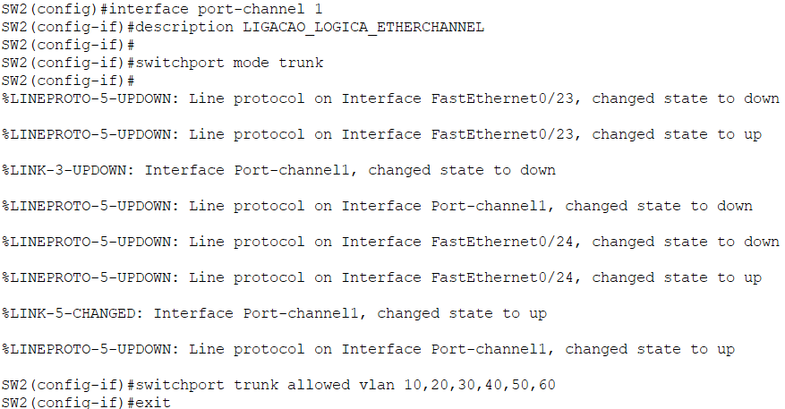
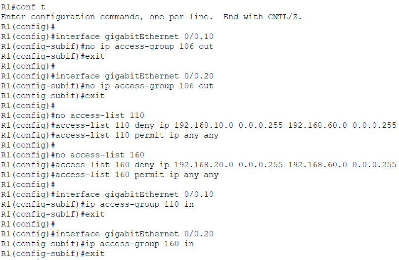
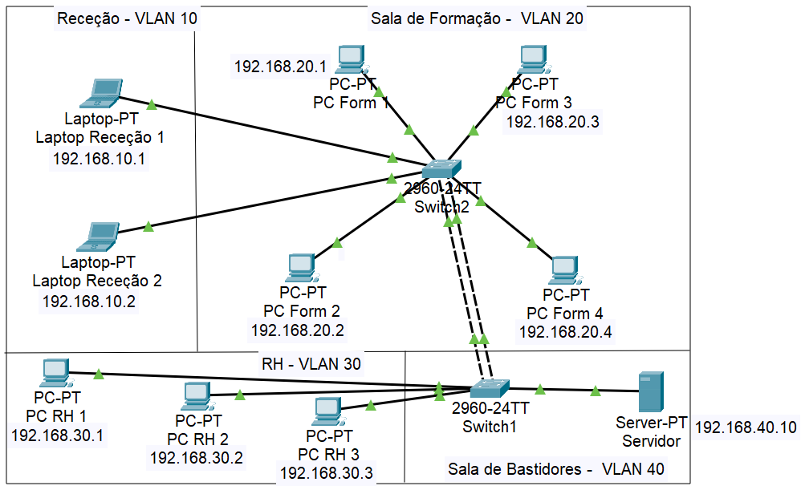
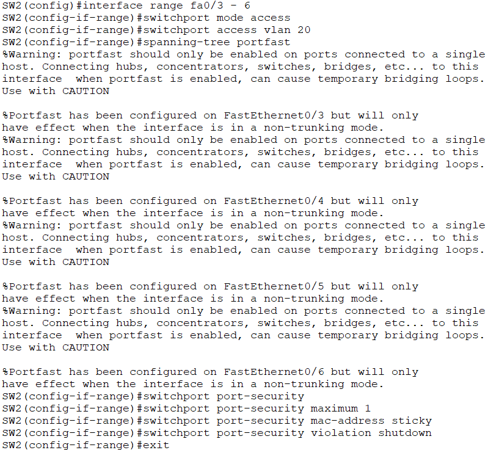
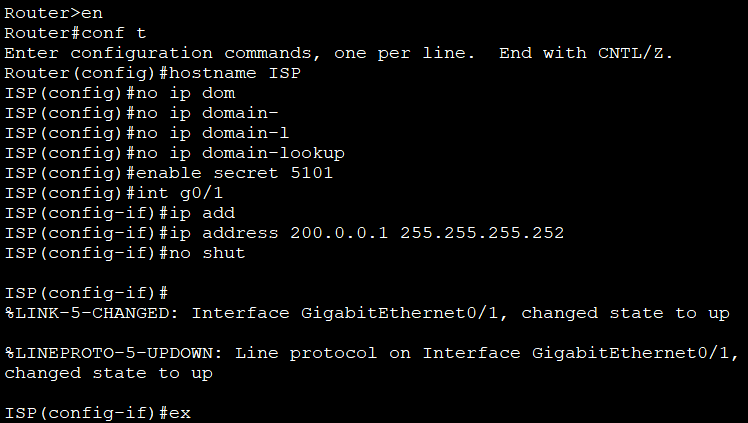
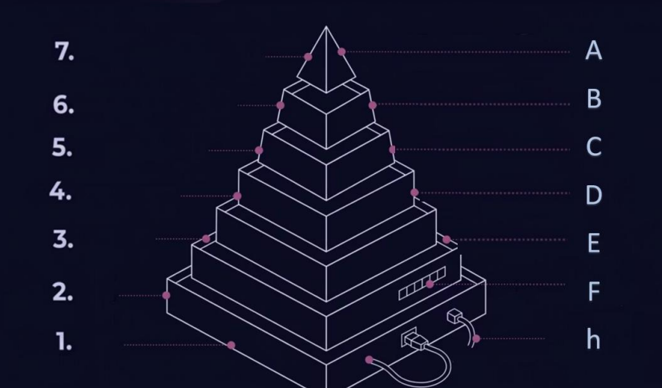
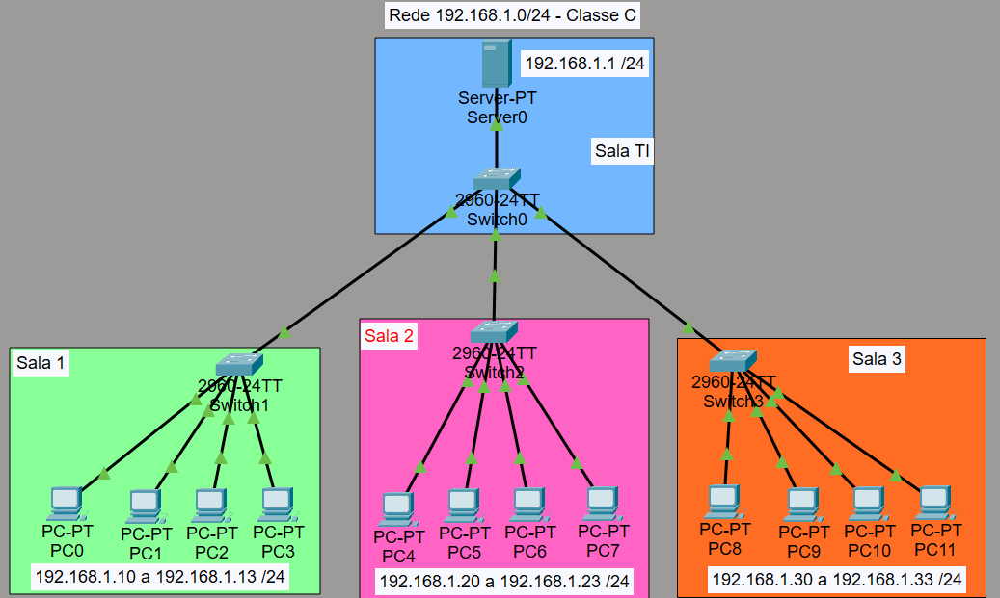

# Infraestrutura de Redes

**Responsável técnica:** Alexandra Carneiro (Técnica de Redes e Segurança)

Planeamento e configuração de uma infraestrutura de rede local: bastidor e hardware, segmentação por VLANs, comutação, encaminhamento inter-VLAN, NAT, segurança física e licenciamento de servidor. Inclui uma proposta completa para dois escritórios e as topologias em Cisco Packet Tracer.

Os cenários usam empresas fictícias (POST e ALGARFIVESTAR) e nomes de teste.

## Bastidor

Planeamento de um bastidor de telecomunicações para uma empresa com 9 postos de trabalho ligados a um switch central, com um servidor dedicado na sala da arrecadação.

| Equipamento | Modelo |
| --- | --- |
| Bastidor 18U | RACK-18UFN-8D (19", 600 x 800 mm, até 300 kg) |
| Servidor | HPE ProLiant DL360 Gen11 (1U, 2 fontes de 1000 W) |
| Switch | Ubiquiti UniFi USW-24-POE Gen2 (24 portas, 16 PoE+, 92 W) |
| Patch panel | Lanberg PPS6-1024-B (24 portas Cat6, 1U) |
| UPS | APC Smart-UPS SMT2200RMI2UC (2200 VA, 1980 W) |
| Gestão de cabos | Painel Lanberg AK-1201-B (1U) |
| Cabos | Patch cords Ewent Cat6 UTP 0,5 m |

- Bastidor de chão de 19 polegadas com 18U: a profundidade de 800 mm é a mínima para servidores e UPS de rack (os bastidores de parede de 450 mm ou 600 mm não chegam). Os equipamentos iniciais ocupam cerca de 8U a 9U, por isso ficam mais de 45% livres para crescer.
- Servidor como controlador de domínio (Active Directory e DNS), DHCP, file server e backups automáticos. Duas fontes de alimentação hot-swap e discos SSD; até 2 CPUs e 8 TB de RAM DDR5.
- Switch a 1U com 16 portas PoE+ para alimentar as câmaras de videovigilância pelo cabo de rede, sem fontes externas. 14 portas livres e 2 slots SFP para fibra.
- Patch panel para organizar os cabos Cat6 que vêm das salas e espelhá-los em tomadas numeradas na frente do bastidor, com ligação ao switch por patch cords.
- UPS de 2U com 9 saídas IEC, ecrã LCD, monitorização remota (SmartConnect) e baterias hot-swap. A carga inicial estimada é de 370 W, muito abaixo da capacidade de 1980 W.

## Bastidor 2.0

Evolução do bastidor anterior: junta fibra ótica, router/firewall e ventilação ativa, com ligação por fibra a um bastidor secundário no exterior do edifício.

| U | Equipamento | Função |
| --- | --- | --- |
| 18 | Bandeja de ventilação | Extração de ar quente e monitorização da temperatura |
| 17 | ODF / Patch panel de fibra | Receção do cabo de fibra que vem do exterior |
| 16 | Patch panel RJ45 | Organização da cablagem de cobre |
| 15 | Organizador de cabos | Arrumação dos cabos de interligação |
| 14 | Switch Ubiquiti USW-24-POE | Distribuição local e alimentação das câmaras |
| 13 | Router / Firewall UDM-Pro | Controlo e segurança de acesso à internet |
| 12 | Espaço livre | Isolamento térmico e circulação de ar |
| 11 | Servidor HPE ProLiant Gen11 | Centralização dos serviços críticos |

- A profundidade de 800 mm também salvaguarda o raio de curvatura seguro dos cabos de fibra ótica. A distribuição ocupa 10U dos 18U (44% livres).
- ODF para receber a fibra do exterior e fazer as fusões na instalação inicial.
- Router/firewall UDM-Pro com regras de firewall avançadas e prevenção de intrusões, a proteger o acesso à internet.
- Servidor com as mesmas funções (domínio, DNS, DHCP, ficheiros, backups) e arquivo centralizado das gravações de videovigilância.

## Segurança física

Avaliação da segurança física dos escritórios da POST, no piso 1 de um edifício misto (residencial e comercial), com computadores portáteis, desktops e um servidor central.

Falhas encontradas no sistema instalado:

- Acesso livre ao terraço pelas escadas públicas: as fachadas norte e este dão para um terraço ajardinado, sem barreira física nem controlo de acessos.
- Janelas exteriores de correr (vidro com caixilharia de alumínio, persianas de PVC, parapeito a 0,85 m), fáceis de forçar por alavancagem.
- Parque de estacionamento aberto no rés-do-chão, sem vigilância, por baixo do escritório.
- Sete sensores de infravermelhos tapados por biombos de 1,70 m e estores interiores: criam zonas mortas onde um intruso circula sem acionar o alarme.
- Sem sensores magnéticos de abertura nem de quebra de vidro nas portas e janelas: o alarme só toca depois de o intruso já ter entrado.
- Porta oeste deixada apenas encostada pelos funcionários (para fumar ou ir à casa de banho); a rececionista trabalha de costas para as secretárias e o servidor.

Medidas corretivas propostas:

- Mola hidráulica na porta oeste para fechar sozinha, com fecho eletrónico por cartão ou tag.
- Sensores magnéticos de abertura e de quebra de vidro em todas as janelas e portas das fachadas norte e este, para deteção no momento da tentativa de entrada.

## Rede POST: VLANs e endereçamento

Projeto e implementação da rede local para as novas instalações da empresa POST, em Cisco Packet Tracer: 17 computadores, 2 impressoras de rede, 1 servidor central, 8 câmaras IP, 1 router e 2 switches de 24 portas.

| VLAN | Zona | Sub-rede | Gateway |
| --- | --- | --- | --- |
| 10 | Gabinetes | 192.168.10.0/24 | 192.168.10.1 |
| 20 | Espaços de Trabalho | 192.168.20.0/24 | 192.168.20.1 |
| 30 | Receção | 192.168.30.0/24 | 192.168.30.1 |
| 40 | Sala Técnica (servidor) | 192.168.40.0/24 | 192.168.40.1 |
| 50 | Impressoras | 192.168.50.0/24 | 192.168.50.1 |
| 60 | Segurança (CCTV e painéis) | 192.168.60.0/24 | 192.168.60.1 |

- Segmentação por VLANs para isolar dados administrativos (VLAN 10) e operacionais (VLAN 20); a receção (VLAN 30) tem restrições por ser zona pública; servidor (VLAN 40) e impressoras (VLAN 50) ficam em sub-redes isoladas para travar movimentos laterais; videovigilância e segurança física concentradas na VLAN 60.
- EtherChannel entre os dois switches (port-channel 1, modo trunk, com as VLANs 10, 20, 30, 40, 50 e 60 permitidas) para agregar largura de banda e redundância.

*EtherChannel no SW2: interface port-channel 1, modo trunk, com as VLANs 10, 20, 30, 40, 50 e 60 permitidas.*

- Encaminhamento inter-VLAN com subinterfaces lógicas dot1Q no router R1 (uma por VLAN, com o gateway respetivo) e ligação trunk do router ao switch principal.
- Segurança da infraestrutura: port-security nas portas de acesso e listas de controlo de acesso (ACLs) para bloquear o tráfego entre VLANs que não deve comunicar.

*ACLs no R1: a lista 110 bloqueia a VLAN 10 (Gabinetes) para a VLAN 60 (Segurança) e a lista 160 bloqueia a VLAN 20 (Espaços de Trabalho) para a VLAN 60, aplicadas nas subinterfaces.*

- Testes de validação por ping: Receção - Impressoras, Receção - Servidor e Espaços de Trabalho, Receção - Gabinete, Espaços de Trabalho / Gabinete / Receção - Câmara, Gabinete - Servidor, Câmaras - Servidor e Impressoras - Servidor.
- Pontos fracos identificados: a receção pode aceder às impressoras e as impressoras comunicam com o resto da rede, o que pode servir de ponte para alcançar o servidor; não há rede sem fios isolada para visitantes.

## Switch: VLANs e port-security

Configuração de dois switches (2960-24TT) com segmentação por departamento:

| VLAN | Nome | Uso |
| --- | --- | --- |
| 10 | RECECAO | Receção |
| 20 | FORMACAO | Sala de formação |
| 30 | RH | Recursos Humanos |
| 40 | SERVIDOR | Serviços críticos |

*Topologia: Switch1 e Switch2 (2960-24TT) com as VLANs 10 (Receção), 20 (Formação), 30 (RH) e 40 (Servidor), e os endereços IP dos postos.*

- Resolução de nomes por DNS desativada (`no ip domain-lookup`) e palavra-passe cifrada no modo privilegiado (`enable secret`).
- Ligação entre os dois switches em modo trunk nas duas portas, para transportar o tráfego de todas as VLANs.
- Portas de acesso associadas à VLAN de cada posto, com spanning-tree portfast para convergência rápida.
- Port-security em cada porta: máximo de 1 endereço MAC (sticky, aprendido de forma dinâmica) e bloqueio imediato da interface (`violation shutdown`) em caso de acesso não autorizado.

*Portfast e port-security no SW2 (portas Fa0/3 a Fa0/6, VLAN 20): máximo de 1 MAC sticky por porta e bloqueio da interface em caso de violação.*

## Router e NAT

Configuração do router (empresa ALGARFIVESTAR) em Cisco Packet Tracer: encaminhamento inter-VLAN e acesso à internet por NAT.

- Subinterfaces no router R1 (router-on-a-stick) como gateways das VLANs: G0/0.10 (192.168.10.1), G0/0.20 (192.168.20.1), G0/0.30 (192.168.30.1) e G0/0.40 (192.168.40.1), com encapsulamento dot1Q.
- Porta G0/0 do R1 ligada ao switch principal em modo trunk; G0/1 ligada ao router da operadora (ISP).
- Router da operadora (ISP) com o endereço 200.0.0.1/30 na interface G0/1.

*Router da operadora (ISP): nome, palavra-passe cifrada no modo privilegiado e endereço 200.0.0.1/30 na interface G0/1.*

- Rota por omissão para a internet e NAT com overload (PAT) com ACLs, para os postos internos saírem com o endereço público.
- Testes de validação: comunicação entre dispositivos do mesmo departamento, entre departamentos, com o servidor e com a internet.

## Modelos de rede (OSI e TCP/IP)

Modelo OSI (7 camadas) e modelo TCP/IP, com os protocolos e serviços de cada camada:

| Camada OSI | Função | Protocolos / serviços |
| --- | --- | --- |
| 7 - Aplicação | Interface com as aplicações | HTTP, FTP, SMTP, DNS, DHCP |
| 6 - Apresentação | Encriptação e compressão de dados | SSL/TLS, JPEG, ASCII, MP3 |
| 5 - Sessão | Controlo de sessões entre aplicações | NetBIOS, RPC, SQL |
| 4 - Transporte | Controlo de erros e entrega fim-a-fim | TCP, UDP |
| 3 - Rede | Endereçamento lógico e encaminhamento | IP (IPv4/IPv6), ICMP, roteamento |
| 2 - Ligação de Dados | Endereçamento físico e acesso ao meio | Ethernet, switch, endereço MAC |
| 1 - Física | Transmissão de sinais elétricos e físicos | Cabos (UTP, fibra), hubs, bits |

*Modelo OSI: as 7 camadas, da Física (1) à Aplicação (7).*

- Correspondência entre o modelo TCP/IP e o modelo OSI, com os protocolos de cada nível.
- Sub-redes: rede 192.168.1.0/24 (classe C) com um servidor (192.168.1.1), três salas e 12 postos (Sala 1: 192.168.1.10 a 192.168.1.13; Sala 2: 192.168.1.20 a 192.168.1.23; Sala 3: 192.168.1.30 a 192.168.1.33).

*Rede 192.168.1.0/24: servidor 192.168.1.1 e três salas com 4 postos cada.*

## Licenciamento Windows Server

Modelo de licenciamento para um servidor físico com Windows Server 2022 (empresa POST), com Active Directory, DNS, DHCP, servidor de ficheiros e servidor de impressão.

- Hardware: 2 processadores físicos com 10 núcleos cada, 20 núcleos no total; 2 máquinas virtuais no arranque, com previsão de mais 2 (4 no total); 16 postos de trabalho e 16 utilizadores.
- Edição recomendada: Windows Server 2022 Standard (até 2 máquinas virtuais com o licenciamento dos núcleos; para 4 máquinas virtuais, são precisas mais 20 licenças de núcleo). A edição Datacenter (virtualização ilimitada) não foi a escolhida para este cenário.
- Núcleos a licenciar: 20 (mínimo de 8 por processador e 16 por servidor cumpridos). Para a expansão para 4 máquinas virtuais, mais 20 licenças de núcleo, 40 no total.
- CALs: o modelo é "Core + CAL" — a licença do servidor só dá o direito de instalar o sistema; cada utilizador ou dispositivo precisa de uma CAL (User CAL ou Device CAL). Com Remote Desktop Services, são precisas CALs de RDS adicionais.

## Proposta: dois escritórios

Proposta técnica para a rede de um edifício de escritórios em dois espaços: o escritório principal no rés-do-chão (cerca de 340 m²) e o escritório secundário no 12.º andar (cerca de 240 m²).

- Backbone redundante em fibra ótica multimodo OM4 entre as arrecadações técnicas, com duas ligações em paralelo em agregação (LACP / EtherChannel) por portas SFP+, 20 Gbps e sem ponto único de falha.
- Rés-do-chão: bastidor de chão de 18U/22U com dois switches geríveis de 24 portas Gigabit PoE+. 12.º andar: bastidor de parede de 12U com um switch gerível de 24 portas Gigabit PoE+.
- Servidor físico em rack no rés-do-chão (fontes redundantes, RAID) com Windows Server 2022 Standard e 22 Device CALs.
- Videovigilância IP: 12 câmaras de alta definição com visão noturna e PoE (8 no rés-do-chão, 4 no 12.º andar) e gravador NVR de 16 canais com disco de 6 TB, 30 dias de retenção (conforme as regras de proteção de dados).
- Rede 100% por cabo, sem Wi-Fi. Cablagem Cat6 (860 metros) e fibra ótica OM4 (120 metros) por tetos falsos e calhas técnicas de superfície, sem abrir roços nem furar a estrutura.
- Esquema lógico (VLANs e endereçamento IP), esquema físico e topologia, etiquetagem dos pontos de rede, inventário de equipamentos, prazos e garantias.

## Análise de necessidades e planeamento

Antes de desenhar ou instalar uma rede, é preciso levantar as necessidades da organização: planta do edifício, número de utilizadores e dispositivos, escalabilidade e segurança. Esta é a fase de arquitetura — a fase estratégica que define a estrutura lógica da rede antes de qualquer desenho técnico ou instalação.

O planeamento cobre:

- Funções da rede: acesso à internet, partilha de ficheiros, impressão em rede, acesso remoto (VPN), rede isolada para visitantes e separação de departamentos.
- Questões técnicas: número de dispositivos, pisos, largura de banda, dados sensíveis e firewall.
- Crescimento da rede: previsão a 1 ou 2 anos, novos colaboradores, novos departamentos e novos equipamentos.
- Logística e instalação: prazos, horário de instalação, tipo de cablagem e calhas técnicas.

## Packet Tracer

Topologias em Cisco Packet Tracer (ficheiros `.pkt`, abrir no Packet Tracer):

- `Projeto-Post.pkt` - topologia do projeto da rede POST (VLANs, switches, router e servidor)
- `Projeto-Post-2.pkt` - segunda versão da topologia do projeto POST
- `Topologia-2.pkt` - topologia de rede local
- `Topologia-2-Copia.pkt` - cópia da topologia 2
- `Topologia-3.pkt` - topologia com router (encaminhamento inter-VLAN e NAT)
- `Modelos-Protocolo-9.pkt` - topologia para os modelos de protocolo (OSI/TCP-IP)
- `Modelos-Protocolo-10.pkt` - topologia para os modelos de protocolo (OSI/TCP-IP)

## Ficheiros

- `Bastidor.pdf` - bastidor 18U, servidor, switch, patch panel, UPS e cablagem
- `Bastidor-2.0.pdf` - bastidor com fibra ótica (ODF), router/firewall e ventilação
- `Seguranca-Fisica.pdf` - avaliação da segurança física dos escritórios da POST
- `Rede-POST-VLANs.pdf` - projeto da rede POST: VLANs, EtherChannel, inter-VLAN, ACLs e testes
- `Configuracao-Switch-VLANs.pdf` - configuração dos switches (VLANs, trunk, portfast, port-security)
- `Configuracao-Router-NAT.pdf` - configuração do router (subinterfaces, NAT/PAT, ISP e testes)
- `Modelos-OSI-TCP-IP.pdf` - modelo OSI e modelo TCP/IP
- `Licenciamento-Windows-Server.pdf` - licenciamento Windows Server 2022 (núcleos e CALs)
- `Proposta-Infraestrutura-Dois-Escritorios.pdf` - proposta para dois escritórios (fibra, racks e CCTV)
- `Analise-de-Necessidades.pdf` - análise de necessidades antes de desenhar uma rede
- `Planeamento-Rede.pdf` - questionário de planeamento (funções, técnica, crescimento e logística)

## Notas

- Ambiente de laboratório e cenários fictícios. Os nomes das empresas (POST, ALGARFIVESTAR), dos departamentos e dos utilizadores são de teste.
- As imagens são capturas das topologias e das configurações em Cisco Packet Tracer e diagramas dos documentos; os PDFs ficam como prova completa.
